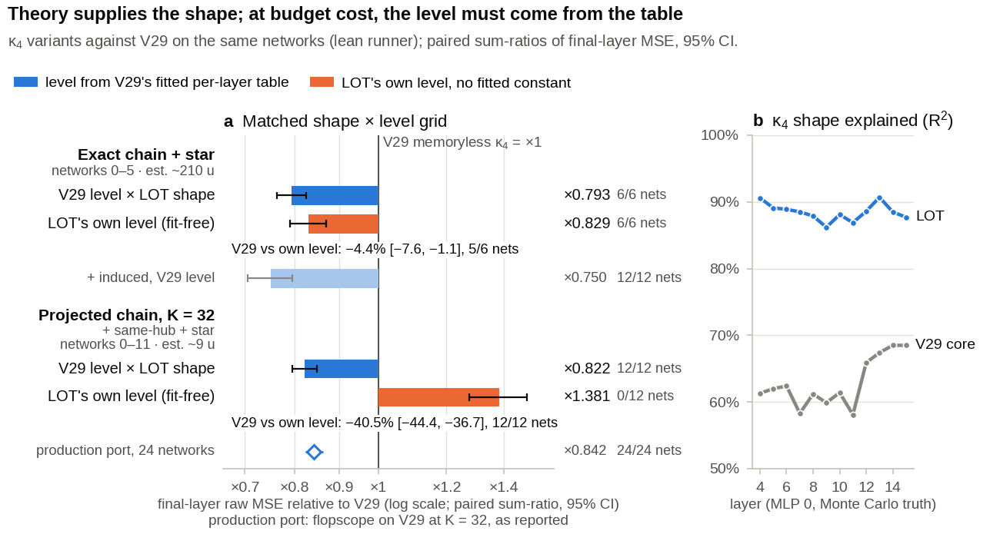

# Shape from theory, level from data

**ARC White-Box Estimation Challenge 2026 · Phase 2 · AIcrowd antoniu_gugu9 · submission #337608**

The write-up corresponds to submission #337608 only.

The estimator computes the per-neuron means of random 1024-wide, 16-layer ReLU networks by propagating a cumulant chain: 504aldo's public V29, built on ARC's cumulant propagation. The main change, **LOT** (leading-order trees), computes the neuron-to-neuron *shape* of the fourth cumulant from leading-order trees, while V29's fitted table keeps its per-layer *level*. **HZ**, a small learned correction built on LOT's exact terms, keeps interpretable weights. The graded score of #337608 is **2.02 × 10⁻⁹**, ×0.375 of V29's leaderboard score of 5.40 × 10⁻⁹.



*Theory supplies the shape; for the affordable form, the level had to come from the table. Paired over development networks with Monte Carlo truth (paper Table 1; recomputed by `checks/recompute.py`).*

## Start here

- [`paper/writeup.pdf`](paper/writeup.pdf): the write-up.
- [`docs/READING_GUIDE.md`](docs/READING_GUIDE.md): every mechanism in the paper, mapped to code lines.
- `python3 -I verify.py`: checks that `estimator/estimator.py` is byte-identical to graded #337608 and rebuilds the three graded controls byte for byte. It needs only the standard library and ends with `VERIFY OK`.
- `python3 -I checks/recompute.py`: recomputes Table 1 from the shipped per-network logs and the graded knock-out statistics from the grader's per-MLP scores, asserting the Table 1 rows and the graded knock-out rows against the tables the paper uses. Standard library, about one second; ends with `RECOMPUTE OK`.

## Graded results

| build | switched off | submission | score | final-layer MSE | FLOPs / B | score vs s43 |
|:--|:--|:--|--:|--:|--:|--:|
| **#337608 (this release)** | – | 337608 | **2.0236e-9** | 1.5413e-8 | 0.1313 | – |
| s43 (base of the controls) | – | 336780 | 2.1438e-9 | 1.6069e-8 | 0.1334 | 1 |
| s43 + `PORTLOT=0` | LOT, and HZ, which is built on it | 336912 | 3.1803e-9 | 2.1814e-8 | 0.1458 | ×1.484 |
| s43 + `HZ_ON=0` | HZ | 336911 | 2.4749e-9 | 1.9738e-8 | 0.1254 | ×1.154 |
| s43 + `D21_CUT=99` | the demand projection (every row of the κ₃ slice D21 computed exactly) | 336913 | 2.3157e-9 | 1.6020e-8 | 0.1446 | ×1.080 |

- All numbers come from the official grader. It runs 100 MLPs per submission (every run here completed all 100); the numbers shown are over the 50 public ones. The prize ranking uses a fresh private suite.
- Removing LOT alone (the LOT-off control against the HZ-off control) costs ×1.105 in MSE (worse on 47 of 50 MLPs) and ×1.285 in score (50 of 50).
- Nominated for the private re-evaluation: #337632 (#337608 with only the head weights changed) and #337120 (an earlier, wall-time-safe build). See [`docs/SUBMISSIONS.md`](docs/SUBMISSIONS.md).
- The controls modify s43, the 17 October build, not #337608; they were graded on 18 October. See [`controls/`](controls/README.md).

## What is new

1. **LOT, leading-order trees for the κ₄ diagonal** (paper §3; [`READING_GUIDE` M3](docs/READING_GUIDE.md)).
   - At tree level, one linear functional ψᵢ of the Gaussian backbone gives both D₃ = 3·Cov(L, ψ) and κ₄'s chain term = 12·Var(ψ); star and induced terms complete the diagonal. This is a closed-form resummation of ARC's tree-level diagonal over all birth layers. It follows that the chain term is ≥ (4/3)·D₃²/σ². The derivation and a toy check are in [`docs/LOT_DERIVATION.md`](docs/LOT_DERIVATION.md) and [`checks/`](checks/).
   - The deployable form projects ψ on a 12-dimensional approximation of the dominant covariance subspace and keeps V29's per-layer level. In Puffi's terms it is a response closure whose coupling is derived up to that per-layer scale.
   - On matched terms, the projected form (32 modes) *at its own level* is 38% worse than V29 and 18% better at V29's level. The exact form is 17–21% better even at its own level, but it would add more than the whole bill of #337608. Hack2Publish (forum topic 18290) found the same pattern-versus-level split independently, by oracle injection.
2. **HZ, a learned correction on derived features** (§4; M9).
   - Its features are LOT's exact diagram terms, and its weights are fitted to the chain's own local error.
   - In two separate fits the induced term's weight averages 1.01 and 1.00 over layers (sd 0.11 and 0.12), against a theoretical value of 1, and the cross-source chain gets 0.82–0.84. V29's own diagonal is driven to zero.
3. **When "more correct" hurts, measured** (§5; M7). The chain's levels compensate for its truncations. Replacing a level breaks the chain; replacing a shape does not. Two removals of double counting, Kuznetsov's marg2 rule and halving the D² diagrams (pair terms quadratic in the D21 slice), were supported on a 300-network holdout that no earlier decision had used.

## Derived vs fitted

LOT adds no fitted table of its own: its level is V29's fitted table, and its only own constants are the size K = 12, chosen in a joint refit with other knobs, and two hand-set fallback bounds.

The estimator holds 8,935 fitted numbers that affect predictions:
- the non-linear head, 7,488 parameters (weights and biases) plus 1,066 normalisation constants;
- HZ's weights, 336 slots;
- V29's κ₄ regeneration tables, 31 numbers;
- the 14-number b₁ table of the two-term (3,1) closure, copied from kai_leal_gonzalez's MIT repository.

Every constant is classified in [`docs/INVENTORY.md`](docs/INVENTORY.md).

## Reproduce

| goal | command | needs | expected |
|:--|:--|:--|:--|
| verify the release | `python3 -I verify.py` | standard library | `VERIFY OK` |
| recompute Table 1 and the graded knock-out statistics | `python3 -I checks/recompute.py` | standard library | `RECOMPUTE OK` |
| rebuild the three graded controls | `python3 -I controls/make_controls.py` | standard library | three sha256 matches |
| run the estimator | `pip install -r requirements.txt` then `python3 verify.py --smoke` (64×4, the small-shape fallback) or `--smoke 1024x16` (the scored path) | flopscope 0.12.3, whestbench 0.16.1 (the grader ran it within its 8 GiB limit) | a finite prediction, then `VERIFY OK` |
| rebuild the figures | `cd figures && python3 make_figures.py` | numpy, matplotlib | byte-identical figures |
| rebuild the paper | `bash paper/build.sh` | pandoc, pdflatex | `paper/writeup.pdf` |
| retrain HZ and the head | see [`training/README.md`](training/README.md) | PyTorch; network dumps (not shipped) | head weights within noise |

## Repository map

| path | contents | paper |
|:--|:--|:--|
| `estimator/` | the graded file of #337608, its manifest and sha256 | all |
| `controls/` | the s43 base file and the three one-knob controls, rebuilt and hash-checked | §3.4, §6 |
| `docs/READING_GUIDE.md` | execution path, paper notation to code, 14 mechanisms, all 374 knobs, dead code, time guards | all |
| `docs/INVENTORY.md` | every embedded table and constant: derived, fitted, hand-set or inherited | §3.2, §4 |
| `docs/PROVENANCE.md` | what is inherited, ported, re-derived or new, with line ranges | §8 |
| `docs/SUBMISSIONS.md` | the graded submissions referenced in the paper | App. B |
| `docs/EVIDENCE.md` | the ledger rows behind every evidence tag in the paper | all |
| `docs/negative_results.csv` | the catalogue of 61 negative results | §7, App. D |
| `docs/LOT_DERIVATION.md` | full derivation of LOT: proofs, scope, code correspondence, prior work | §3, App. A |
| `checks/lot_toy_check.py` | numerical check of every LOT identity on toy networks (numpy, about 1 min) and its output | App. A |
| `checks/recompute.py`, `checks/data/` | the raw data behind Table 1 (per-network logs of the lean runs, scored against the public dataset's Monte Carlo means) and the graded knock-outs (per-MLP public scores and FLOPs from the official grader), and the script that recomputes both | Table 1, §3.4, §6 |
| `training/` | scripts that produced HZ's weights and the head | §4 |
| `figures/` | every figure, the data behind it (each CSV has a `source` column) and the script | all |
| `paper/` | the write-up's source and PDF | – |

## Before reusing the code

- **Time guards.** Three wall-clock guards (103.5 s, 107.5 s and 117 s) stop HZ's work when a predict runs late, and the prediction is then the no-HZ one. Their s43-era predecessors (100/105/112 s) fired on a slow grader worker in a later build (s44, #336845); none fired in #337608's graded run. [`READING_GUIDE` §6](docs/READING_GUIDE.md) gives the settings for a timing-independent run.
- **Shapes.** For any shape other than 1024 × 16, the estimator switches off everything added after the 15 October build (s26) and falls back to V29's chain, without κ₄ regeneration, LOT or HZ ([§7](docs/READING_GUIDE.md)).
- **Dead code.** Code that is dead at the default settings is listed in [§5](docs/READING_GUIDE.md).

## What did not work

Paper §7 and Appendix D list the negative results. Examples: injecting the true K22, the (2,2) slice of κ₄ (×1.25 worse), scale-covariant repairs (×1.1 to ×351 worse), cheapening HZ's features by an accurate closure, and more training data for the head (saturated).

## Credits

- **ARC:** cumulant propagation, term tables, `factor_k4`.
- **504aldo:** V29, the base of this estimator.
- **Artyom Kuznetsov (Artyom_Mazur):** the marg2 rule, their Proposition 1 (the random-projection view of error transport), the "3+2" tree.
- **LordProcciuto:** the frozen-join basis scheme (FIJA2), its trims and the old-tier legs (OLD_HOT1), ported.
- **kai_leal_gonzalez:** the two-term (3,1) closure.
- **Yinita:** the H18 per-row metric (idea, re-implemented).
- **il.miscusi:** the scale mode.
- **Puffi:** the response closure, prior art for a mode-projected κ₄ with a fitted level.
- **Susupro:** readout observability (their Proposition 2).
- **Luna:** the Ward defect and an aligned chaos model with the 4/3 equality case.
- **megan_park:** the survival law S(ℓ).
- **Nurlanggs:** edge history.
- **Hisernberg and hyojun_kwon:** end-to-end and final-loss training of correctors.
- **mliston:** learned readouts fitted on the estimator's own trajectories.
- **LuDoe, megan_park and pranay212:** parallel "truer κ₄ hurts" findings; **yeongjunyoo:** the counterpoint that an injected true κ₄ helps.
- **huang_chung_yi:** a clock-only wall guard.
- **Hack2Publish (mdhamidhosen, esfer_sami, foyshal_sk):** an independent oracle measurement of the same κ₄ pattern-versus-level split, a cubic-star feature equal to LOT's star term, and a κ₃-dressed C·T readout related to LOT's induced term (forum topic 18290).
- **neopok919:** readers for κ₄ born from κ₃, and the incomplete-κ₃ mechanism (forum topic 18293).
- **AndreasHad04:** linearised mean propagation with the per-layer arcsin law, and a κ₃-derived lower bound on κ₄ mixed in at fitted weights (forum topic 18292).
- **marius_binner:** a κ₄ star read on carried κ₃ legs, described in public submission notes (#330172, 7 September).
- **michael_anderson7:** noise-corrected oracles (forum topic 18272).

Details are in paper §8. The licences are in [`THIRD_PARTY_NOTICES.md`](THIRD_PARTY_NOTICES.md).

## How this was made

The project was run as a directed multi-agent search.

- **The author** set the objective, the evaluation rules and the compliance rules, and proposed research directions from their own reading of the literature and the competition forum, alongside the agents' proposals. They organised the search in rounds of parallel agents with a stated aim each, and when agents reported a ceiling, kept the search going by suggesting new directions from their understanding of the problem. They asked for the generalisation check that became the untouched 300-network holdout, allocated the rented compute, and made every submission, nomination and release decision.
- **The agents** (Claude models through Claude Code throughout the phase; an OpenAI Codex session on 2–7 October) wrote the code, ran the experiments and proposed most of the individual ideas, including the LOT derivation.

Separate verification agents checked the paper's numbers against logged runs and grader telemetry, and the discrepancies they found were corrected. The LOT identities were re-derived and checked numerically on toy networks (paper Appendix A).

## Cite

See [`CITATION.cff`](CITATION.cff).

```bibtex
@software{gugu2026shape,
  author = {Gugu, Antoniu},
  title  = {Shape from theory, level from data: {ARC} White-Box Estimation Challenge 2026, Phase 2, submission \#337608},
  year   = {2026},
  url    = {https://github.com/atgugu/arc-whitebox-lot}
}
```

## Licence

MIT ([`LICENSE`](LICENSE)). Third-party parts keep their notices ([`THIRD_PARTY_NOTICES.md`](THIRD_PARTY_NOTICES.md)).
